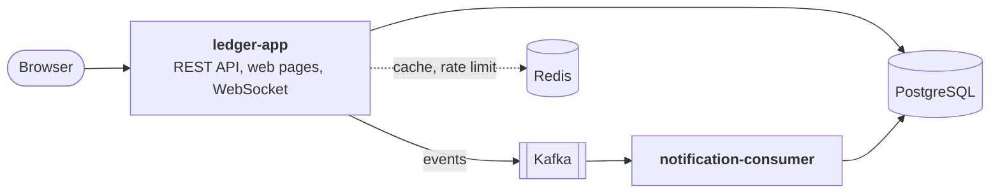
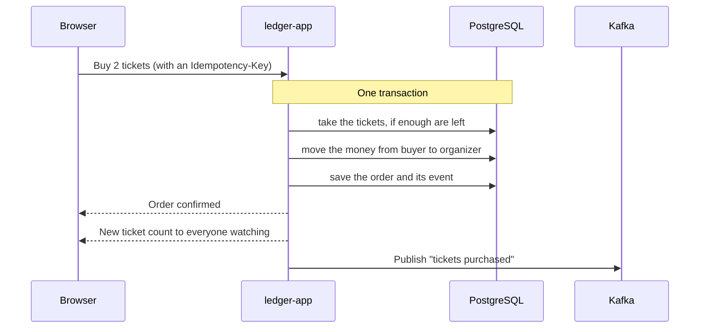

# Ledgerly

[](https://github.com/HoangThanhMan/ledgerly/actions/workflows/ci.yml)


Event ticketing with a built-in wallet. Buyers top up a wallet and pay for tickets from it; organizers create events and get paid into theirs.

Under the hood every payment goes through a double-entry ledger, built so that money is never lost or created twice, even when many people buy at once, a client retries, or a server crashes halfway.


## Try it

You need Docker with Compose.

```bash
git clone https://github.com/HoangThanhMan/ledgerly.git
cd ledgerly
docker compose --profile full up -d --wait
```

Open http://localhost:8080, then:

1. Sign up, open a wallet and deposit some demo money.
2. Open the event *Ledgerly Live* and buy a ticket.
3. Open the same event in a second tab and buy again: the count of tickets left changes in both tabs.
4. Press "Gửi lại (cùng key)" to resend the same order. You get the first result back and are not charged again.

The API is documented at http://localhost:8080/swagger-ui.html. To stop everything: `docker compose --profile full down`.

## Features

- **Accounts:** sign up and sign in as a buyer or an organizer.
- **Wallet:** open a wallet, deposit demo money, see the balance and history, send money to another wallet.
- **Events:** organizers create events with ticket classes and prices; anyone can browse them.
- **Tickets:** buy up to 4 tickets of a class, paid from the wallet, and see them under "Vé của tôi" (my tickets).
- **Live updates:** the number of tickets left updates on every open page as tickets sell.
- **Notifications:** every purchase and transfer creates a notification, through Kafka.

The pages are in Vietnamese and served by the application itself; everything they do is also available as a REST API.

## Architecture



- **`ledger-app`** is a modular monolith holding users, wallets, the ledger, events and orders. Because they share one database, buying a ticket is a single transaction: the tickets, the payment and the order are saved together or not at all.
- **`notification-consumer`** is a separate service that reads events from Kafka and writes notifications. If it is down, sales continue.
- **PostgreSQL** is the source of truth. **Redis** only speeds things up; if it fails, the app keeps working without it.

When someone buys tickets:



## How it stays correct

- **No overselling.** Tickets are taken with a single conditional update, so two buyers can never get the last ticket.
- **No double spending.** A wallet is locked while it is charged, and the database itself refuses a negative balance.
- **Safe retries.** Every payment request carries an `Idempotency-Key`. Sending it again returns the first result instead of charging twice.
- **No lost events.** Events are saved in the same transaction as the payment and published to Kafka afterwards (transactional outbox).
- **No duplicate notifications.** The consumer remembers which events it has already handled.
- **Private wallets.** Users sign in with a JWT and can only see and spend from their own wallets.

Each of these is backed by integration tests against real PostgreSQL, Kafka and Redis (Testcontainers), including tests where hundreds of buyers compete for the same tickets and tests that simulate crashes at the worst moment.

## API

| Method | Path | Description |
|---|---|---|
| `POST` | `/v1/auth/register`, `/v1/auth/login` | Sign up, sign in |
| `POST`, `GET` | `/v1/wallets` | Open a wallet, list my wallets |
| `GET` | `/v1/wallets/{id}`, `/v1/wallets/{id}/entries` | Balance and history |
| `POST` | `/v1/admin/deposits` | Deposit demo money |
| `POST` | `/v1/transfers` | Send money to another wallet |
| `GET`, `POST` | `/v1/events` | List events, create an event (organizers) |
| `GET`, `PATCH` | `/v1/events/{id}` | Event details, edit an event |
| `POST`, `GET` | `/v1/orders` | Buy tickets, list my orders |
| WebSocket | `/ws` | Live ticket counts (STOMP, `/topic/ticket-classes/{id}`) |

Requests other than sign-up, sign-in and browsing events need an `Authorization: Bearer <token>` header. Requests that move money also need an `Idempotency-Key` header. The full reference is in Swagger UI and in [`openapi.yaml`](ledger-app/openapi.yaml).

## Development

```bash
docker compose up -d --wait                                         # PostgreSQL, Kafka, Redis
./gradlew :ledger-app:bootRun --args='--ledgerly.demo.seed=true'    # the app on :8080
./gradlew :notification-consumer:bootRun                            # the consumer on :8082

./gradlew build                                                     # all checks and tests
```

Settings live in each application's `application.yaml`. For anything beyond a local demo, set your own `LEDGERLY_SECURITY_JWT_SECRET`.

Metrics and traces are available in Grafana with the `observability` profile:

```bash
LEDGERLY_PROFILES=compose,observability docker compose --profile full --profile observability up -d --wait
```

Then open http://localhost:3000 (admin / admin).

## Tech stack

Java 25, Spring Boot 4, PostgreSQL, Kafka, Redis, WebSocket (STOMP), Spring Security with JWT, plain HTML/CSS/JavaScript, JUnit 5, Testcontainers, ArchUnit, k6, OpenTelemetry with Grafana, Docker Compose, GitHub Actions.

## Project layout

| Directory | Contents |
|---|---|
| [`ledger-app`](ledger-app) | The main application and its web pages |
| [`notification-consumer`](notification-consumer) | The notification service |
| [`ledger-contracts`](ledger-contracts) | Event types shared by both applications |
| [`infra`](infra), [`perf`](perf), [`scripts`](scripts) | Database setup and Grafana dashboard, load tests, helper scripts |

## Limitations

- Money is demo money only: there is no connection to a bank.
- Anyone can sign up as an organizer.
- Only one currency (VND), and live ticket counts assume a single app instance.
- Not deployed anywhere; it runs locally with Docker Compose.

## Author

[@HoangThanhMan](https://github.com/HoangThanhMan)
