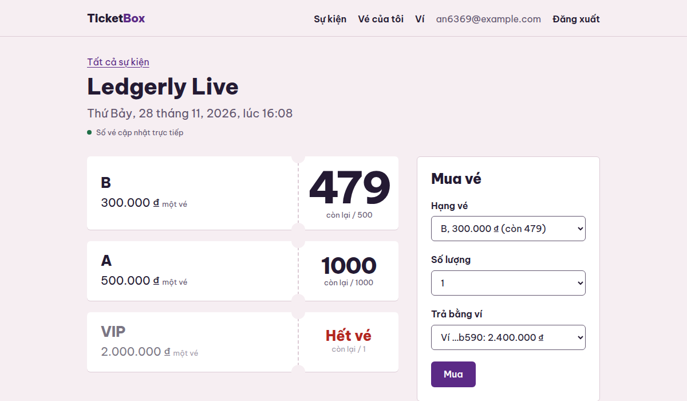
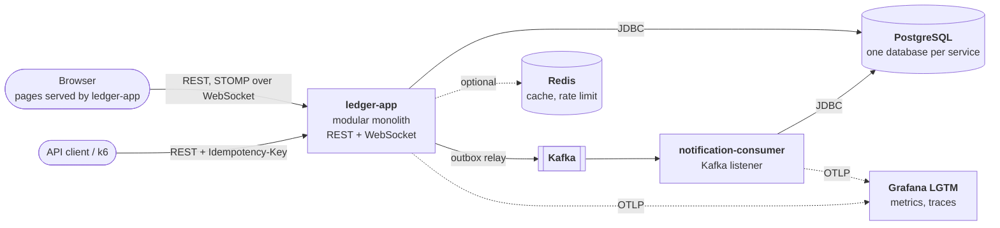
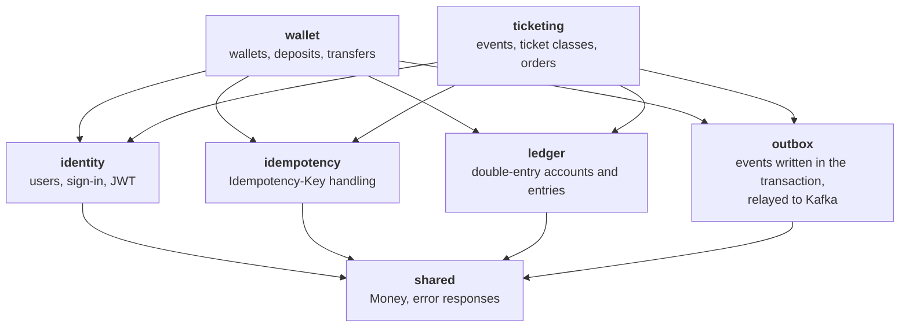
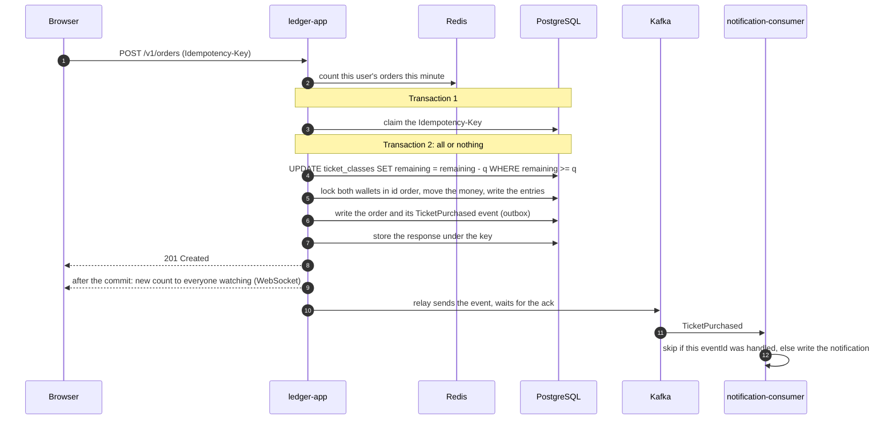
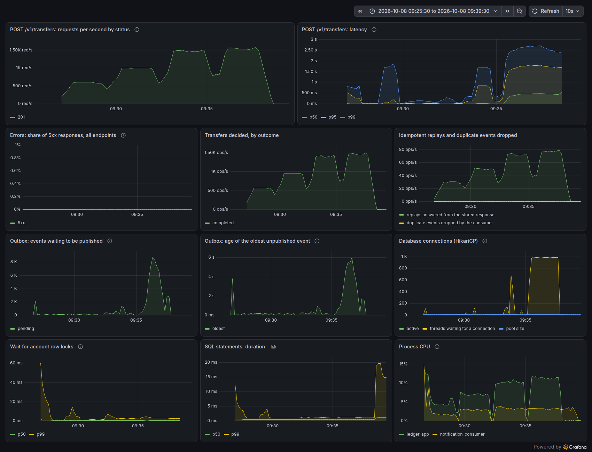

# Ledgerly

[](https://github.com/HoangThanhMan/ledgerly/actions/workflows/ci.yml)


Event ticketing with a built-in wallet, on a double-entry ledger that does not lose or invent money, not under concurrent buyers, not when a client retries, not when a process dies midway.



Buyers top up a wallet, then pay for tickets from it. Organizers create events and are paid into their own wallet. Wallets can also send money to each other. The browser pages in the screenshot are in Vietnamese and come with the application; everything they do is also a REST API.

The interesting part is not the features but what happens at the edges: hundreds of people buying the last tickets at once, a phone that loses its connection right after pressing "Buy", a server killed between writing to the database and publishing the event. Each of those cases has a test that proves nothing is sold twice, charged twice or lost.

## Contents

- [Try it](#try-it)
- [Features](#features)
- [Architecture](#architecture)
- [How it stays correct](#how-it-stays-correct)
- [API](#api)
- [Development](#development)
- [Testing](#testing)
- [Performance](#performance)
- [Design decisions](#design-decisions)
- [Tech stack](#tech-stack)
- [Repository layout](#repository-layout)
- [Current limitations](#current-limitations)

## Try it

You need Docker with Compose v2, and the ports 8080, 8082, 5433, 6379 and 9092 free.

```bash
git clone https://github.com/HoangThanhMan/ledgerly.git
cd ledgerly
docker compose --profile full up -d --wait
```

Then open **http://localhost:8080**:

1. Sign up ("Đăng ký"). You land on your wallet.
2. Open a wallet ("Mở ví") and deposit demo money ("Nạp tiền"), for example `5000000`.
3. Go to the events ("Sự kiện"), open *Ledgerly Live* and buy tickets ("Mua").
4. Open the same event in a second tab: a purchase in one tab changes the count in the other without a reload.
5. Press "Gửi lại (cùng key)" to send the same order again. It answers with the first result and charges nothing more.

The first start builds the images from source and takes a few minutes. Later starts take about 12 seconds. The API reference is at http://localhost:8080/swagger-ui.html. A demo organizer is ready to use: `organizer@ledgerly.dev`, password `organizer-demo`.

To stop: `docker compose --profile full down`, with `-v` to delete the data too.

## Features

**For buyers**

- Sign up and sign in with an email and a password.
- Open a wallet in VND, deposit demo money, see the balance and every change to it.
- Browse upcoming events and their ticket classes, with the tickets left in each class updated live.
- Buy 1 to 4 tickets of a class, paid from the wallet. Clear messages when tickets run out, the wallet is short, or the user orders too fast.
- See past orders under "Vé của tôi", and get a notification for every purchase.
- Send money to another wallet.

**For organizers**

- Create an event with its ticket classes (name, price, number of tickets), then rename or reschedule it.
- Be paid for every ticket sold, into the wallet chosen for the event.

**Behind the pages**

- Every request that moves money takes an `Idempotency-Key`, so a retry never charges twice.
- Every transfer and purchase publishes an event to Kafka; a separate service turns it into a notification, exactly once.
- Event pages are cached in Redis and orders are rate-limited per user. If Redis goes down, the application keeps selling without it.
- Metrics and traces in Grafana: one purchase is one trace, from the HTTP request through every SQL statement to the consumer.

## Architecture

### The parts



- **`ledger-app`** holds everything that touches money: users, wallets, the ledger, events, tickets, orders. Keeping them in one process and one database makes a purchase a single local transaction: the tickets, the payment and the order commit together or not at all.
- **`notification-consumer`** is a separate process with its own database. It reads events from Kafka and writes notifications. If it is slow or down, sales go on.
- **PostgreSQL** is the source of truth. **Redis** only saves work and can be lost. **Kafka** carries events between the two applications.

### Modules inside `ledger-app`



Each module is a package with a small public API at its root and everything else under `internal`. A test ([`ArchitectureTest`](ledger-app/src/test/java/dev/ledgerly/ArchitectureTest.java)) fails the build if a module reaches into another's internals, if a cycle appears, or if a transaction is opened outside the application layer.

### What happens when someone buys tickets



The tickets, the money, the order, the event and the stored response are one transaction. So there is no moment where the tickets are gone but unpaid, the money moved but the event was lost, or a retry buys again. A transfer between wallets follows the same path without the ticket step.

## How it stays correct

| What could go wrong | What prevents it | Proven by |
|---|---|---|
| **Selling more tickets than exist** when many people want the last ones | One conditional `UPDATE ... WHERE remaining >= q` checks and takes the tickets in a single statement. A `CHECK` keeps `remaining` between 0 and the class size | `ConcurrentPurchaseIT`: 500 buyers, 100 tickets, exactly 100 orders. [`overselling.sh`](scripts/spikes/overselling.sh) compares four strategies; an unlocked read-then-write kept only 800 of 39,709 sales |
| **Tickets taken but not paid, or paid but not taken** | Tickets, payment, order and event commit in one transaction. A buyer who cannot pay gets the tickets back inside it | `InsufficientFundsPurchaseIT`, `PurchaseAndTransferIT`, invariants I8 and I9 |
| **Spending the same money twice** | The wallet rows are locked before the balance is checked, and the database rejects a negative balance anyway | `HotWalletDrainIT`: 500 threads take 1 each from a wallet holding 100; exactly 100 succeed |
| **Deadlocks** between opposite transfers | Accounts are always locked in ascending id order | `DeadlockFreedomIT`: 1,000 pairs of opposite transfers, no deadlock. Without the ordering, over 70 |
| **A retry that charges again** after a lost response | `Idempotency-Key`: the first response is stored with the money and replayed to every retry | `IdempotencyConcurrencyIT`: 50 requests with one key, 1 transaction. `PurchaseIdempotencyIT`: 20 sends, 1 order |
| **An event that never goes out**, or goes out for a rolled-back change | Transactional outbox: the event is a row in the same transaction; a relay sends it afterwards | `OutboxAtomicityIT`, `RelayCrashDuplicateIT`. `kill -9` while draining 3,000 events: every transaction got its notification |
| **A notification sent twice** because Kafka redelivered | The consumer remembers each `eventId` in the same transaction as the notification | `ConsumerDedupIT`, `TicketNotificationIT` |
| **A few clients flooding a sale**, or **Redis failing** | 10 orders per user per minute, counted in Redis. Every Redis call gives up after 200 ms, and the request goes on without Redis | `OrderRateLimitIT`; `RedisDownIT`: with Redis frozen, a purchase still succeeds in 0.26 s |
| **Using someone else's wallet** | Wallets belong to the user who opened them; to anyone else they answer `404`, like a wallet that does not exist | `WalletOwnershipIT`, `SecurityIT` |
| **A fake ticket count pushed to everyone** | The WebSocket only lets clients listen; anything they send is dropped | `RemainingBroadcastIT` |

The database is the last line of defence: even with a bug in the Java code, PostgreSQL refuses a negative wallet balance, any change or deletion of a ledger entry, and a transaction whose entries do not sum to zero (checked by a trigger at commit). Money is always a whole number of đồng in a `BIGINT`, never a floating-point number.

## API

| Method | Path | What it does | `Idempotency-Key` |
|---|---|---|:-:|
| `POST` | `/v1/auth/register` | Sign up as `USER` (default) or `ORGANIZER` | |
| `POST` | `/v1/auth/login` | Sign in; returns an access token valid for one hour | |
| `POST` | `/v1/wallets` | Open a wallet | |
| `GET` | `/v1/wallets` | My wallets | |
| `GET` | `/v1/wallets/{id}` | Balance of a wallet | |
| `GET` | `/v1/wallets/{id}/entries` | Its history, newest first (`?after=&limit=`) | |
| `POST` | `/v1/admin/deposits` | Deposit demo money. A user into their own wallets, an organizer into any | Required |
| `POST` | `/v1/transfers` | Send money to another wallet | Required |
| `GET` | `/v1/transfers/{id}` | One of my transfers | |
| `GET` | `/v1/events` | Upcoming events, soonest first (`?page=&size=`). No sign-in | |
| `GET` | `/v1/events/{id}` | An event, its ticket classes and the tickets left. No sign-in | |
| `POST` | `/v1/events` | Create an event with its ticket classes. Organizers only | |
| `PATCH` | `/v1/events/{id}` | Rename or reschedule one of my events | |
| `POST` | `/v1/orders` | Buy 1 to 4 tickets of a class from one of my wallets | Required |
| `GET` | `/v1/orders` | My orders, newest first (`?page=&size=`) | |
| `GET` | `/v1/orders/{id}` | One of my orders | |
| WebSocket | `/ws` | STOMP. Subscribe to `/topic/ticket-classes/{id}` for `{ticketClassId, remaining}` after every sale. No sign-in | |

- **Sign-in:** every other request needs `Authorization: Bearer <accessToken>`, or gets `401`.
- **Amounts** are strings of whole đồng (`"amount": "150000"`), so JavaScript cannot round them.
- **Errors** follow RFC 9457 Problem Details, with a stable `type` such as `/problems/sold-out` or `/problems/insufficient-funds`.
- **Full reference:** Swagger UI at `/swagger-ui.html`, and [`ledger-app/openapi.yaml`](ledger-app/openapi.yaml), which a test keeps identical to what the application serves.

<details>
<summary><b>How retries with <code>Idempotency-Key</code> behave</b></summary>

The client makes up one key (a UUID) for each operation and sends the same key on every retry of it.

| Situation | Response | What the client does |
|---|---|---|
| The first request finished | Its response again, with `Idempotent-Replayed: true` | Use the result |
| The first request is still running | `409 idempotency-in-progress`, `Retry-After: 1` | Wait, resend with the same key |
| Same key, different body or endpoint | `422 idempotency-key-reused` | Fix the client: one key per operation |
| The first request was refused (sold out, not enough money) | The same refusal, even if things changed since | Use a new key to try again |
| The first request failed (`500`, `503`) | Nothing was stored and nothing moved | Resend with the same key |

Keys are kept for at least 24 hours.

</details>

<details>
<summary><b>The same flow with curl</b></summary>

```bash
# Sign up and sign in
curl -s -X POST localhost:8080/v1/auth/register -H 'Content-Type: application/json' \
  -d '{"email":"an@example.com","password":"correct-horse-battery"}'
TOKEN=$(curl -s -X POST localhost:8080/v1/auth/login -H 'Content-Type: application/json' \
  -d '{"email":"an@example.com","password":"correct-horse-battery"}' | jq -r .accessToken)
AUTH="Authorization: Bearer $TOKEN"

# Open a wallet and deposit 500,000 đồng
A=$(curl -s -X POST localhost:8080/v1/wallets -H "$AUTH" -H 'Content-Type: application/json' \
  -d '{"currency":"VND"}' | jq -r .id)
curl -s -X POST localhost:8080/v1/admin/deposits -H "$AUTH" -H 'Content-Type: application/json' \
  -H "Idempotency-Key: $(uuidgen)" -d "{\"walletId\":\"$A\",\"amount\":\"500000\",\"currency\":\"VND\"}"

# The demo event and its class B
EVENT=$(curl -s localhost:8080/v1/events | jq -r '.items[] | select(.name == "Ledgerly Live") | .id')
CLASS=$(curl -s localhost:8080/v1/events/$EVENT | jq -r '.ticketClasses[] | select(.name == "B") | .id')

# Buy one ticket. Run it twice: the second answer carries Idempotent-Replayed: true and buys nothing
KEY=$(uuidgen)
curl -si -X POST localhost:8080/v1/orders -H "$AUTH" -H 'Content-Type: application/json' \
  -H "Idempotency-Key: $KEY" -d "{\"ticketClassId\":\"$CLASS\",\"walletId\":\"$A\",\"quantity\":1}"

# Tickets left, my orders, my balance
curl -s localhost:8080/v1/events/$EVENT | jq '.ticketClasses[] | {name, remaining}'
curl -s -H "$AUTH" localhost:8080/v1/orders
curl -s -H "$AUTH" localhost:8080/v1/wallets/$A

# The notification the consumer wrote, and the ledger checks (each query must return 0 rows)
docker compose exec postgres psql -U ledgerly -d notification -c 'SELECT message FROM notifications'
docker compose exec -T postgres psql -U ledgerly -d ledger < scripts/invariants.sql
```

</details>

## Development

Requirements: Docker, and JDK 17 or later to run Gradle (it downloads the JDK 25 it compiles with).

```bash
docker compose up -d --wait                  # PostgreSQL :5433, Kafka :9092, Redis :6379
./gradlew :ledger-app:bootRun --args='--ledgerly.demo.seed=true'
./gradlew :notification-consumer:bootRun
```

`./gradlew :ledger-app:bootTestRun` starts the application with PostgreSQL, Kafka and Redis in Testcontainers, without compose.

**Metrics and traces.** Start Grafana and the applications with the `observability` profile, then open http://localhost:3000 (admin / admin). The Ledgerly dashboard is the home page; traces are under Explore → Tempo.

```bash
LEDGERLY_PROFILES=compose,observability docker compose --profile full --profile observability up -d --wait
```

<details>
<summary><b>Configuration</b></summary>

Defaults are in each application's `application.yaml`; the `compose` profile swaps in the container host names. Override with environment variables, for example `LEDGERLY_TICKETING_RATE_LIMIT_PER_MINUTE=20`.

| Property | Default | Meaning |
|---|---|---|
| `ledgerly.security.jwt.secret` | a development key | Signs the access tokens. **Set `LEDGERLY_SECURITY_JWT_SECRET` anywhere but a development machine** (`openssl rand -base64 32`) |
| `ledgerly.security.jwt.ttl` | `1h` | Lifetime of an access token |
| `ledgerly.demo.seed` | `false` (`true` in compose) | Create the demo organizer and the *Ledgerly Live* event at startup |
| `ledgerly.ticketing.rate-limit.per-minute` | `10` | Orders per user per minute; more get `429` with `Retry-After` |
| `ledgerly.ticketing.lock-timeout` | `2s` | Longest wait for a ticket class lock; then `503` with `Retry-After` |
| `ledgerly.ledger.lock-timeout` | `2s` | Longest wait for the wallet locks; then `503` with `Retry-After` |
| `ledgerly.idempotency.lease` | `30s` | How long a request may hold a key before a retry takes it over |
| `ledgerly.idempotency.ttl` | `24h` | Minimum time a key and its response are kept |
| `ledgerly.outbox.relay.enabled` | `true` | `false`: serve the API but publish no events |
| `ledgerly.outbox.relay.poll-interval`, `batch-size` | `200ms`, `100` | How often and how much the relay sends |
| `spring.datasource.url` | `jdbc:postgresql://localhost:5433/ledger` | The consumer uses the `notification` database |
| `spring.kafka.bootstrap-servers` | `localhost:9092` | |
| `spring.data.redis.host`, `port` | `localhost`, `6379` | Optional: without Redis, everything is served from PostgreSQL |
| `management.tracing.sampling.probability` | `0.1` | Share of requests traced; `1.0` with the `observability` profile |

</details>

<details>
<summary><b>The container images</b></summary>

One [`Dockerfile`](Dockerfile) builds both applications (`--build-arg MODULE=ledger-app`): a layered jar so a code change does not re-ship the 92 MB of dependencies, an unprivileged user, and a Java 25 AOT cache that halves startup (`ledger-app`: 2.07 s instead of 4.09 s, median of 5).

</details>

## Testing

```bash
./gradlew build              # everything: formatting, static checks, unit and integration tests, coverage
./gradlew integrationTest    # against real PostgreSQL, Kafka and Redis in Testcontainers
```

- **Real infrastructure, no mocks of it.** No H2: tests run on the PostgreSQL version the application runs on.
- **Concurrency tests check the books, not just for errors.** After each run, the same SQL as [`scripts/invariants.sql`](scripts/invariants.sql) must return no rows.
- **Crashes are staged on purpose:** after the money moved but before the key was completed, after Kafka got an event but before the relay recorded it, with Redis frozen mid-request.
- **The packaged system is tested in CI:** it builds the images, starts everything with compose and runs [`scripts/smoke-test.sh`](scripts/smoke-test.sh).
- **Strict build:** Spotless formatting, Error Prone, NullAway (JSpecify), and at least 80% line coverage of the domain packages.

| Invariant | Must always hold |
|---|---|
| I1 | The entries of every transaction sum to zero |
| I2 | No user wallet is negative |
| I3 | Every balance equals the sum of its entries |
| I4 | All balances, system accounts included, sum to zero |
| I5 | One `Idempotency-Key`, at most one transaction |
| I6 | Every transfer has exactly one event, and no event is left unsent |
| I7 | Each event has at most one effect in the consumer |
| I8 | Tickets sold in a class equal the quantities ordered |
| I9 | Every order was paid exactly its amount, from its wallet |
| I10 | Every order has exactly one `TicketPurchased` event |

## Performance

`POST /v1/transfers` with k6 at a constant arrival rate, `ledger-app` pinned to 2 CPU cores, median of three 5-minute runs:

| Measure | Result |
|---|---|
| Latency at 300 requests/s | p50 **2.17 ms**, p95 **4.21 ms**, p99 **17.14 ms**, no errors |
| Ceiling on 2 cores | about **1,560 transfers/s**; the application CPU runs out before PostgreSQL |
| Under overload | the ledger stays correct; every transaction has exactly one event and one notification |

These come from one laptop running everything (i7-11800H, 7 GB RAM), not from a server. In 4 of 11 runs the server also stalled for 0.5 to 6 seconds, for a reason not yet found. Raw results of every run are in [`perf/results`](perf/results).



<details>
<summary><b>How to rerun the benchmark</b></summary>

```bash
docker compose --profile observability up -d --wait
./gradlew :ledger-app:bootJar :notification-consumer:bootJar
export SPRING_PROFILES_ACTIVE=observability MANAGEMENT_TRACING_SAMPLING_PROBABILITY=0.1
taskset -c 0,1 java -Xmx512m -jar ledger-app/build/libs/ledger-app-1.0.0.jar &
java -Xmx256m -jar notification-consumer/build/libs/notification-consumer-1.0.0.jar &
perf/run-baseline.sh "$(date +%F)-baseline" 300 3
```

</details>

## Design decisions

| Question | Choice | Why not the alternative |
|---|---|---|
| Services or monolith? | One modular monolith for everything that touches money, plus one consumer behind Kafka | Separate ticket and wallet services would turn every purchase into a saga: held tickets, expiry, compensating payments |
| How to stop overselling? | A conditional `UPDATE` on the ticket class | `SELECT ... FOR UPDATE` works too but is slower (15% higher p99, measured). Optimistic locking failed 94% of attempts under contention |
| How to stop double spending? | Row locks in id order, at `READ COMMITTED` | Without the ordering it deadlocks (measured). `SERIALIZABLE` and optimistic locking turn contention into retries |
| Which database? | PostgreSQL, with explicit SQL on the money path | MySQL cannot check "entries sum to zero" at commit. JPA alone hides which locks are taken and when |
| Where do idempotency keys live? | In PostgreSQL, committed with the money | In Redis there is a gap between the two commits where a crash makes them disagree |
| How are events published? | A transactional outbox and a polling relay | Writing to Kafka after the database loses events on a crash. Debezium is much more to run |
| What is Redis for? | Only a cache and the rate limit, both failing open | If Redis could stop sales, a component that only saves work would be the weakest link |
| How do users sign in? | JWTs the application issues itself | Keycloak is a heavy second service for features this API does not use |
| Someone else's wallet? | `404`, like a missing wallet | `403` would confirm that the id exists |

## Tech stack

| Area | Choice |
|---|---|
| Language, framework | Java 25 (records, sealed types, virtual threads), Spring Boot 4.1 |
| Data | PostgreSQL 18, Flyway, `JdbcClient` on the money path, JPA for event editing |
| Messaging, realtime | Kafka 4 (KRaft), STOMP over WebSocket |
| Cache | Redis 8 |
| Security | Spring Security resource server, HS256 JWT, BCrypt |
| Frontend | Plain HTML, CSS and JavaScript modules, served by `ledger-app`; no build step |
| Testing | JUnit 5, AssertJ, Testcontainers, ArchUnit, jqwik, k6 |
| Quality | Spotless, Error Prone, NullAway, JaCoCo |
| Observability | OpenTelemetry (Spring Boot starter), Grafana LGTM |
| Build, packaging | Gradle 9, GitHub Actions, Docker multi-stage build with AOT cache, Docker Compose |

## Repository layout

| Directory | Contents |
|---|---|
| [`ledger-app`](ledger-app) | The main application, its modules, and the browser pages in `src/main/resources/static` |
| [`notification-consumer`](notification-consumer) | Turns events into notifications, with its own database |
| [`ledger-contracts`](ledger-contracts) | The event types shared by producer and consumer |
| [`build-logic`](build-logic) | Gradle conventions: Java setup, quality gates, integration tests |
| [`infra`](infra) | Database init script, Grafana dashboard |
| [`perf`](perf), [`scripts`](scripts) | Load tests and their results; invariant checks, smoke test, the overselling spike |

Good places to start reading:

- [`V1__ledger_core.sql`](ledger-app/src/main/resources/db/migration/V1__ledger_core.sql): the ledger and the rules the database enforces.
- [`PurchaseService`](ledger-app/src/main/java/dev/ledgerly/ticketing/internal/application/PurchaseService.java): buying tickets in one transaction.
- [`LedgerService`](ledger-app/src/main/java/dev/ledgerly/ledger/internal/application/LedgerService.java): posting a transaction with ordered locks.
- [`IdempotencyService`](ledger-app/src/main/java/dev/ledgerly/idempotency/internal/application/IdempotencyService.java): claiming and completing a key.
- [`ConcurrentPurchaseIT`](ledger-app/src/integrationTest/java/dev/ledgerly/ticketing/ConcurrentPurchaseIT.java): 500 buyers, 100 tickets.

## Current limitations

- **Demo money only.** There is no bank: money enters a wallet through the demo deposit, and anyone can sign up as an organizer.
- **The default signing key is public.** Set `LEDGERLY_SECURITY_JWT_SECRET` outside development. Tokens cannot be revoked before they expire (one hour).
- **One currency (VND), one instance.** The WebSocket broker lives in the process, so with several instances a watcher only hears about sales made on its own instance.
- **No circuit breaker in front of Redis.** While Redis hangs, each request that uses it waits 200 ms, and orders are not rate-limited.
- **Lists can lag.** The event list is cached for 30 seconds, so an event can stay listed up to 30 seconds after it starts. Purchases always check the real start time.
- **No overload protection.** Past the ceiling, requests queue up rather than being turned away early.
- **A killed consumer delays notifications** by up to 45 seconds, until Kafka hands its partitions back. Nothing is lost or duplicated.
- **A stopped database is noticed slowly:** requests wait 30 seconds for a connection before failing ([#1](https://github.com/HoangThanhMan/ledgerly/issues/1)).
- **Not deployed anywhere.** Images are built locally from source; every number comes from one development machine.

## Contributing

Issues and suggestions are welcome. A pull request needs `./gradlew build` to pass (run `./gradlew spotlessApply` first) and a test for any change in behaviour. Releases are listed in the [changelog](CHANGELOG.md).

## Author

[@HoangThanhMan](https://github.com/HoangThanhMan)

## License

No license file yet, so all rights are reserved by the author.
